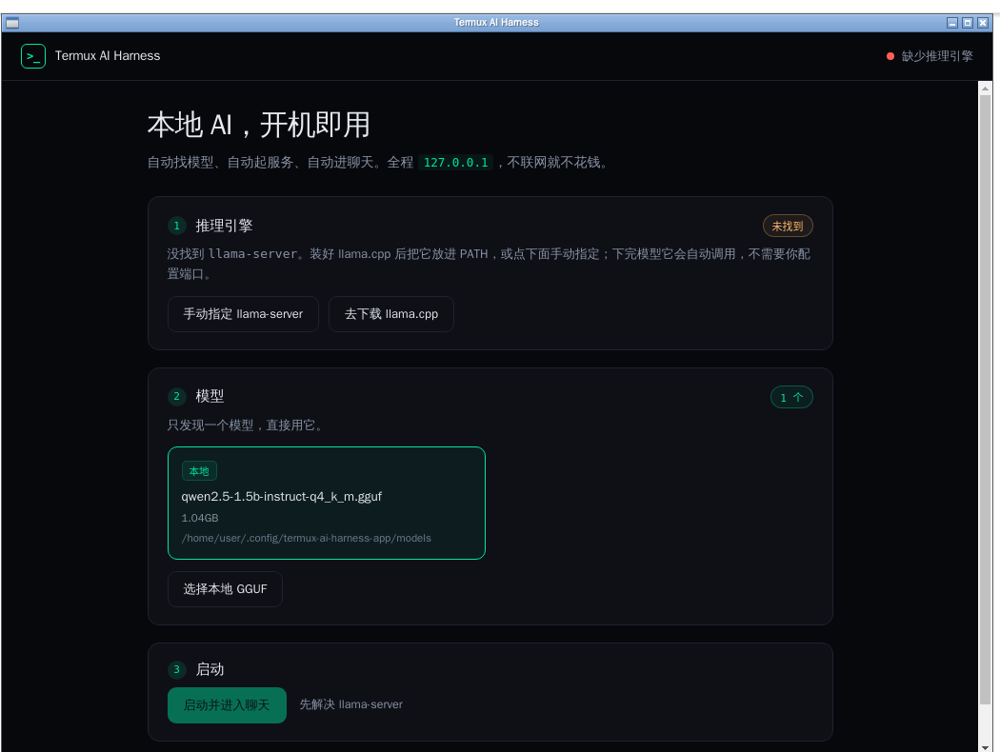
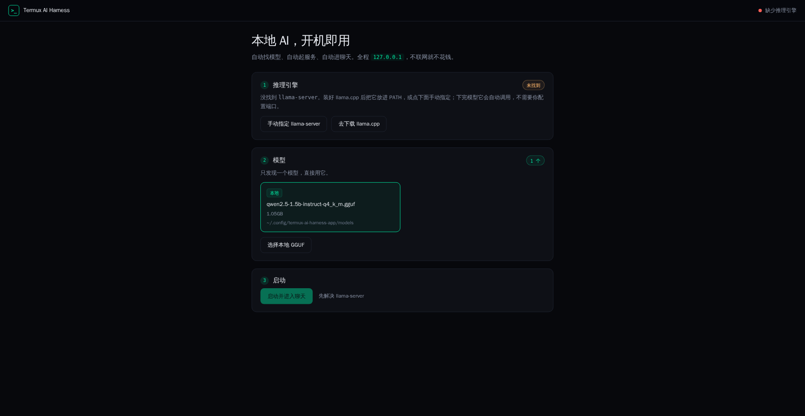

<div align="center">


# Termux AI Harness

**把任何一台机器变成离线 AI 终端**

本地 llama.cpp 推理 · 零 API Key · 断网照常干活

<br />

[](https://github.com/Huangqia123/termux-ai-harness/releases/latest)
[](https://github.com/Huangqia123/termux-ai-harness/releases)
[](https://github.com/Huangqia123/termux-ai-harness/stargazers)
[](LICENSE)

[](#-下载安装)
[](#-它是怎么做到离线的)

[官网](https://huangqia123.github.io/termux-ai-harness/) · [使用手册](https://huangqia123.github.io/termux-ai-harness/manual/) · [下载](#-下载安装) · [常见问题](#-常见问题)

</div>

---

## 项目概述 🧊

**Termux AI Harness** 是一个跑在你自己设备上的 AI 终端。它把 [llama.cpp](https://github.com/ggml-org/llama.cpp) 的 `llama-server` 当推理后端，前面套一个会执行命令的聊天客户端 —— 全程 `127.0.0.1`，不联网也能用。

它不是一个"套壳网页"，而是一个真的能干活的终端：你说的话和你要它执行的命令分开走，`CMD:` 会先摆出来给你看，你按 `y` 才真的执行。

<table>
<tr>
<td width="50%" valign="top">

### 🔒 完全离线

模型、推理、对话记录都在本机。没有 API Key，没有额度，没有"服务器繁忙"。

</td>
<td width="50%" valign="top">

### 🧠 自动就绪

自动找 `llama-server`、自动扫本地 GGUF、一键下模型、端口被占自动顺延，起来就进聊天。

</td>
</tr>
<tr>
<td valign="top">

### 💻 会干活

`TEXT:` 直接回答，`CMD:` 先展示再执行，危险命令（`rm -rf`、`mkfs`、`dd`）直接拦下。

</td>
<td valign="top">

### 🖥️ 五端同源

Android / Linux / Windows / macOS / 网页版，同一套 renderer，同一套协议。

</td>
</tr>
</table>

## ✨ 功能

| 能力 | 说明 |
| :--- | :--- |
| **深度思考** | 请求带 `chat_template_kwargs.enable_thinking`，支持思考的模型（Qwen3 / DeepSeek-R1 蒸馏）先吐 `reasoning_content`，单独收进灰色思考框；不支持的模型自动降级 |
| **联网搜索** | 输入框旁「联网」开关，Bing → DuckDuckGo → 中文维基百科 三级回退，全部免费、不需要 Key，结果喂给模型并要求标注来源 |
| **看图** | 输入框旁「图片」按钮，支持 `Ctrl+V` 粘贴与拖拽，图片压到最长边 1024 转 JPEG，走 OpenAI `image_url` 协议；需要开多模态的 `llama-server` |
| **网页读取** | 聊天里带网址，应用用离屏窗口真实打开它，取渲染后正文 + 首屏截图交给模型，不经过任何第三方 API |
| **中英双语** | 右上角一键切换，静态文案走 `data-i18n`，动态提示走 `I18N.tx()`，语言状态记在 `localStorage` |
| **模型管理** | 按内存推荐档位、列出候选 GGUF、显示体积与量化方式，选完自己下 |

## 🖼️ 界面

<div align="center">

**桌面端（Linux / Windows / macOS）**



**网页版（浏览器打开，连本机 llama-server）**



</div>

## 🎬 60 秒介绍片

一部片子两版字幕语言，都是 1920×1080 / 30fps，代码逐帧渲染 + 代码合成配乐。

- 🇨🇳 [中文版 `TermuxAIHarness-1.5.0-intro.mp4`](https://github.com/Huangqia123/termux-ai-harness/releases/download/v1.5.0/TermuxAIHarness-1.5.0-intro.mp4)
- 🌍 [English version `TermuxAIHarness-1.5.0-intro-en.mp4`](https://github.com/Huangqia123/termux-ai-harness/releases/download/v1.5.0/TermuxAIHarness-1.5.0-intro-en.mp4)

## 📦 下载安装

> [!IMPORTANT]
> 所有安装包都在 [Releases](https://github.com/Huangqia123/termux-ai-harness/releases/latest) 页面，附带 `SHA256SUMS` 校验文件。Android 包**签名固定**，可直接覆盖升级旧版本。

| 平台 | 文件 | 说明 |
| :--- | :--- | :--- |
| 🤖 **Android** | `TermuxAIHarness-x.y.z-android.apk` | 约 44 KB 的 WebView 壳，要求 Android 7.0+（API 24）。装完打开即用，模型与 `llama-server` 需自备 |
| 🐧 **Linux** | `TermuxAIHarness-x.y.z-linux-x86_64.AppImage` | 约 100 MB，`chmod +x` 后双击运行，无需安装依赖 |
| 🪟 **Windows** | `TermuxAIHarness-x.y.z-win-x64.zip` | 约 100 MB，解压即用；仓库根目录的 `windows/install.ps1` 可做开始菜单快捷方式 |
| 🍎 **macOS** | `TermuxAIHarness-x.y.z-mac-arm64.zip` / `-mac-x64.zip` | Apple 芯片与 Intel 双包。未签名，首次打开需右键 → 打开 |
| 🌐 **网页版** | `docs/web/` | 不用装任何东西，浏览器打开静态页，填上本机 `llama-server` 地址即可 |

校验示例：

```bash
sha256sum -c SHA256SUMS-1.5.0.txt
```

## 🚀 快速开始

**1. 准备推理后端**

```bash
# 任意平台，把 llama-server 放进 PATH 或 ~/.local/bin
# https://github.com/ggml-org/llama.cpp/releases
llama-server --version
```

**2. 启动应用**

AppImage / zip / APK 直接打开即可。应用会自己扫模型、自己拉 `llama-server`，8080 被占用自动顺延到 8081–8091。

**3. 命令行方式（Termux / Linux）**

```bash
git clone https://github.com/Huangqia123/termux-ai-harness.git
cd termux-ai-harness
./install.sh          # 装 termuxai / termuxai-harness 到 ~/.local/bin
termuxai              # 起引擎 + 进对话
```

## 🧩 模型档位

| 档位 | 适用设备 | 推荐模型 | 体积 | 上下文 |
| :--- | :--- | :--- | :--- | :--- |
| 轻量 | 4 GB RAM 级 | Qwen2.5-0.5B-Instruct | ~0.4 GB | 1024 |
| 均衡 | 6–8 GB RAM 级 | Qwen2.5-1.5B-Instruct | ~1.1 GB | 1024 |
| 高配 | 8 GB+ RAM 级 | Qwen2.5-3B-Instruct Q4_K_M | ~2.0 GB | 2048 |

细节见 [MODELS.md](MODELS.md)。3B 相比 1.5B 最值的地方不是速度，而是**守格式** —— `CMD:` / `TEXT:` 前缀协议 1.5B 经常忘，3B 基本能守住，误判率明显下降。

## 🗂️ 目录结构

```text
termux-ai-harness/
├── app/                 # Electron 桌面端（main / preload / renderer / web.js）
├── android/             # Android WebView 壳（aapt2 + d8 + apksigner 直接构建，不需要 Gradle）
├── docs/
│   ├── index.html       # 官网（中英双语，下载数据实时拉 Releases）
│   ├── web/             # 网页版 UI
│   ├── manual/          # 20 页中文手册
│   └── backup/          # 备用站
├── bin/                 # termuxai / termuxai-harness 启动器
├── windows/             # PowerShell 安装与启动脚本
├── install.sh           # Termux / Linux 安装脚本
├── download-models.sh   # 模型下载
└── build/icons/         # 应用图标
```

## 🛠️ 从源码构建

```bash
# 桌面端（当前平台）
cd app
npm install
npm run dist

# Android（需要 android-sdk build-tools 34 + JDK）
cd android && cat BUILD.md
```

桌面端三平台产物由 `electron-builder` 产出（`app/dist-app/`）；Android 走 `aapt2 → d8 → zipalign → apksigner`，**签名必须沿用 `android/signing/termux-ai-harness.keystore`**，换 key 会导致老用户无法覆盖安装。

## 🔍 它是怎么做到离线的

- 推理：本机 `llama-server`，OpenAI 兼容的 `/v1/chat/completions`，SSE 流式
- 对话：只在内存与本地 `localStorage` / `userData` 里，不上传
- 模型：GGUF 文件放本地，应用只负责扫描和推荐
- 联网搜索：**只有开关打开时才触发**，走公开的 Bing / DuckDuckGo / 维基接口，不需要任何 Key
- 网页读取：离屏 `BrowserWindow` 本机加载，`executeJavaScript` 取正文，`capturePage()` 截图落 `userData/shots/`

## ❓ 常见问题

<details>
<summary><b>没有 llama-server 能启动吗？</b></summary>

能。界面会正常打开并明确告诉你缺什么，补上后重启引擎即可。
</details>

<details>
<summary><b>回复开头出现 null / 空片？</b></summary>

1.3.0 已修：llama.cpp 的 SSE 首片 `delta.content` 常是 JSON `null`，现在空片直接丢弃。
</details>

<details>
<summary><b>Android 装完打不开模型？</summary>

APK 只是 44 KB 的界面壳，模型和 `llama-server` 需要另外放。推荐先用 Termux 把 `llama-server` 装好，再让 App 指向它。
</details>

## 📄 许可与致谢

- 本项目：[MIT](LICENSE) © Huangqia123
- 推理引擎：[llama.cpp](https://github.com/ggml-org/llama.cpp)（MIT）
- 模型：[Qwen2.5 系列](https://huggingface.co/Qwen)（Apache-2.0）
- 字体与图标许可见 [THIRD-PARTY-NOTICES.md](THIRD-PARTY-NOTICES.md)

<div align="center">
<br />
<sub>Built for people who want their AI to work when the network doesn't.</sub>
</div>
